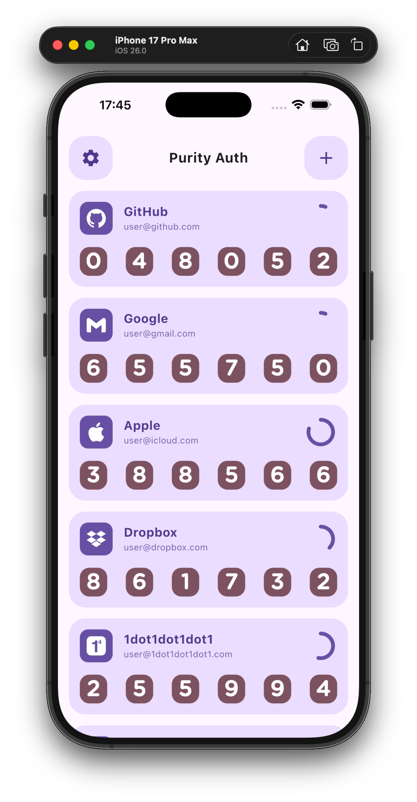
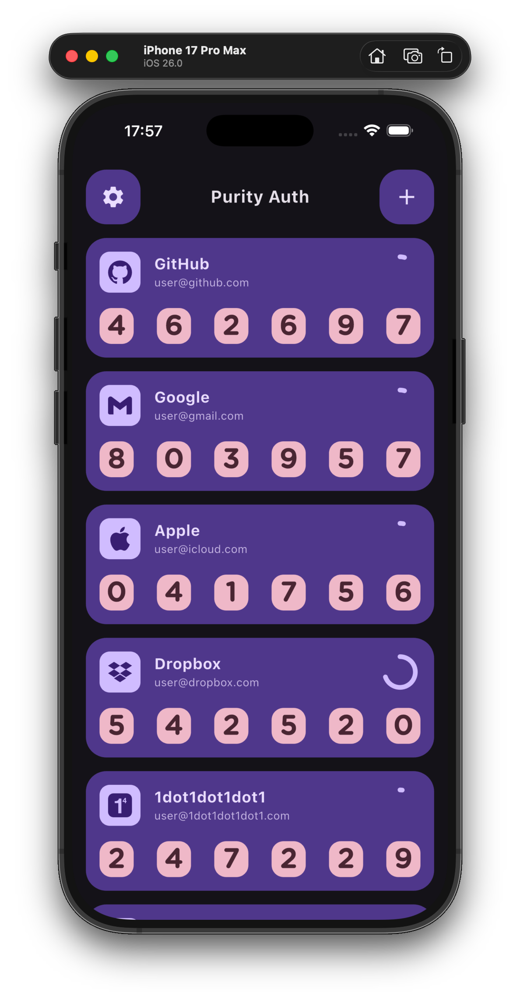
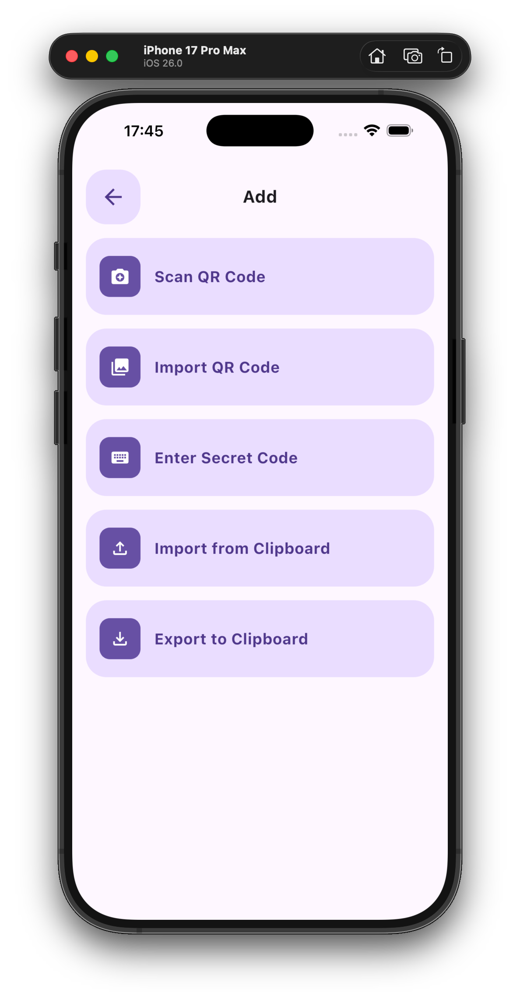
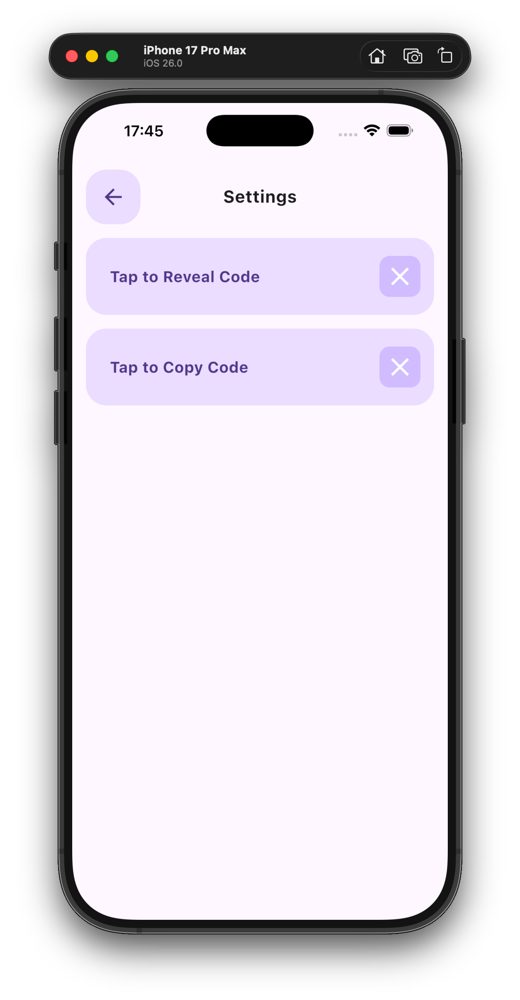
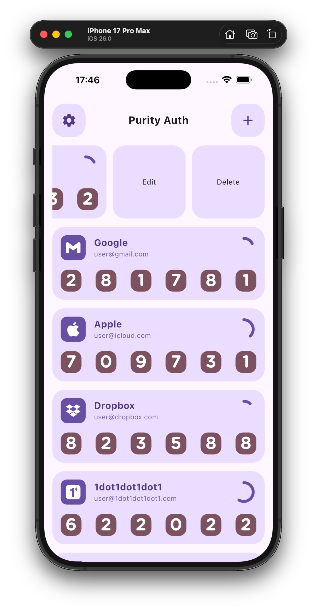
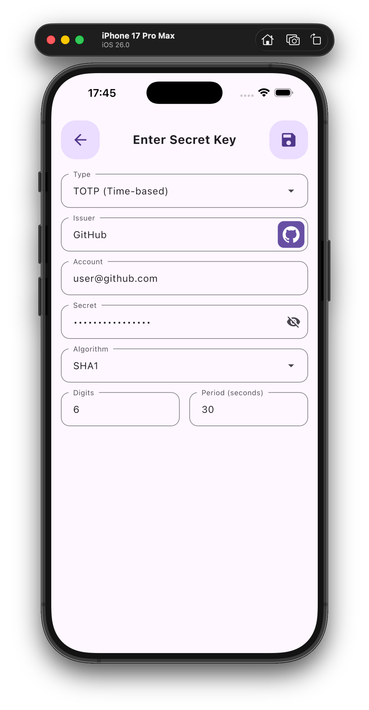
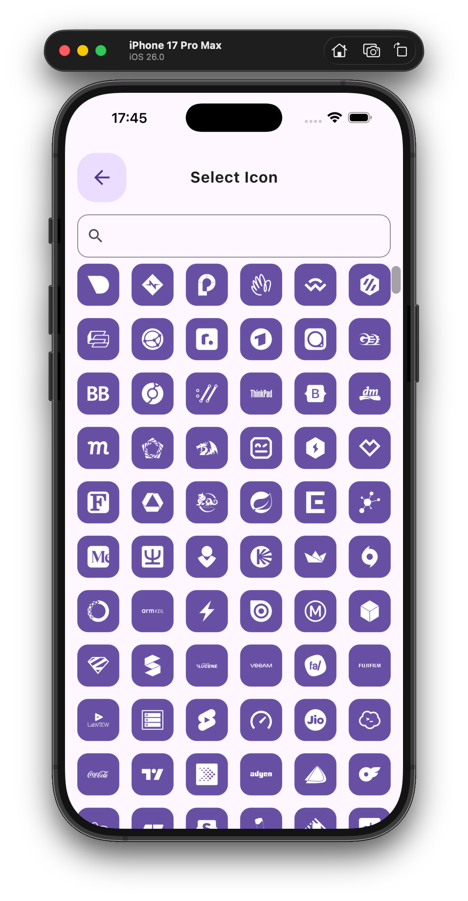

  

# Authentication

一款基于 RFC 6238 标准的离线双因素认证（2FA）管理工具，旨在提供极简的凭证存储与一次性密码生成方案，支持 Windows、macOS、Linux、Android、iOS 及 Web 端。

## 简介

本程序是一款专注于双重身份验证（2FA）的离线客户端。与常见集成了繁杂云同步功能的认证应用不同，Authentication 的设计逻辑完全聚焦于本地密钥管理与 TOTP 动态码的实时生成。程序架构上彻底移除了网络通信模块，不请求任何敏感系统权限，确保所有认证种子数据仅存在于本地沙盒环境。

相较于依赖云端的解决方案，本程序更偏向“极简与绝对控制”。用户无需担心凭证泄露或第三方隐私收集风险，所有操作逻辑均在本地闭环完成，是针对账户安全保护的纯粹本地化工具。

## 应用截图

   
   
   
   
   
   
   

## 构建与发布

构建需要 Flutter 3.47 或更高版本；GitHub Actions 使用 Flutter 3.47.6。

GitHub Actions 在 `master` 上使用 Release Please 根据 Conventional Commits 维护版本 PR 和更新日志。合并版本 PR 后，工作流创建 GitHub Release，构建 Android arm64 APK、可上传至 Google Play 的签名 App Bundle（AAB）和未签名的 iOS IPA，并上传附件。推送标签也会触发构建；Actions 页面可以手动运行构建，填写已有 Release 标签以上传附件，留空则只构建。iOS IPA 需要自行签名后安装。Dependabot 每周检查 Dart 依赖更新。

启用发布前，在仓库的 Actions 设置中允许工作流创建和批准 Pull Request，并配置以下仓库 Secrets：

- `ANDROID_KEYSTORE_BASE64`：Android 签名密钥库文件的 Base64 内容。
- `ANDROID_KEYSTORE_PASSWORD`：密钥库密码。
- `ANDROID_KEY_ALIAS`：签名密钥别名。
- `ANDROID_KEY_PASSWORD`：签名密钥密码。

应使用与已有安装包相同的签名密钥，否则新 APK 无法覆盖安装。Android 和 iOS 构建都成功后才会上传 Release 附件；工作流失败时可在 Actions 页面查看日志并重试。

本地构建 Android Release 时，可在 `android/key.properties` 配置 `storeFile`、`storePassword`、`keyAlias` 和 `keyPassword`；`storeFile` 相对于 `android` 目录。密钥文件和配置不得提交到仓库。

## 致谢

感谢以下开源项目的支持：

- [daegalus/dart-otp](https://github.com/daegalus/dart-otp)
- [elliotwutingfeng/motp](https://github.com/elliotwutingfeng/motp)
- [stratumauth](https://github.com/stratumauth/app)
- [simple-icons](https://github.com/simple-icons/simple-icons)
- [drift](https://pub.dev/packages/drift)
- [google_mlkit_barcode_scanning](https://pub.dev/packages/google_mlkit_barcode_scanning)
- [dynamic_color](https://pub.dev/packages/dynamic_color)
- [flutter_swipe_action_cell](https://pub.dev/packages/flutter_swipe_action_cell)
- [mobile_scanner](https://github.com/juliansteenbakker/mobile_scanner)

## 许可证

本项目遵循 [GPL-3.0 License](LICENSE)。
